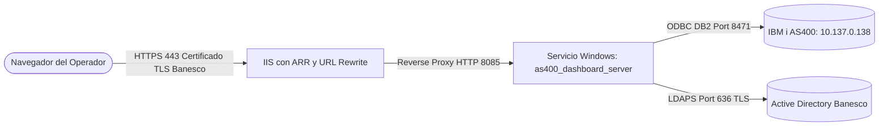

# Guía de Despliegue y Continuidad Operativa 24/7 (Opción 1: Servicio Windows + IIS)

Esta guía documenta la implementación de la **Opción 1** seleccionada para operar el **Dashboard de Administración de Seguridad IBM i AS400** de forma ininterrumpida (24/7) en un servidor Windows Server corporativo de Banesco.

---

## 1. Arquitectura de la Solución 24/7



### Componentes:
1. **Backend Daemon (Puerto Local 8085):**
   - El script `as400_dashboard_server.ps1` se ejecuta como servicio en segundo plano bajo la cuenta `NT AUTHORITY\SYSTEM` o una cuenta de servicio de dominio `gMSA`.
   - **Tolerancia a fallos:** Configurado con reinicio automático inmediato ante cualquier excepción (*Crash Recovery*).
   - **Arranque:** Inicia automáticamente al encender el servidor sin necesidad de que un usuario inicie sesión en Windows (`Automatic - Delayed Start`).

2. **Frontend & Terminación TLS (Puerto 443 HTTPS):**
   - Publicado a través de **IIS (Internet Information Services)** utilizando **ARR (Application Request Routing)** y **URL Rewrite**.
   - Provee terminación TLS segura con el certificado oficial de la entidad bancaria (ej. `https://as400admin.intra.banesco.com`).
   - Inyecta encabezados de seguridad HTTP corporativos (*HSTS, X-Frame-Options, CSP*).

---

## 2. Comandos de Administración del Servicio

El script [install_service_dashboard.ps1](../scripts/install_service_dashboard.ps1) automatiza toda la gestión del servicio:

### 2.1 Instalar el Servicio (Ejecutar como Administrador)
```powershell
powershell.exe -ExecutionPolicy Bypass -File "d:\WKESPEREIRA\D\Scripts\.agents\skills\skill-as400-admin-dashboard\scripts\install_service_dashboard.ps1" -Action Install -Port 8085
```

### 2.2 Verificar el Estado del Servicio
```powershell
powershell.exe -ExecutionPolicy Bypass -File "d:\WKESPEREIRA\D\Scripts\.agents\skills\skill-as400-admin-dashboard\scripts\install_service_dashboard.ps1" -Action Status -Port 8085
```
Respuesta esperada:
```text
=== ESTADO DEL SERVICIO BanescoAS400Dashboard ===
  Nombre       : BanescoAS400Dashboard
  Descripcion  : Banesco AS400 Security Dashboard (24/7)
  Estado       : Running
  Tipo Inicio  : Automatic
```

### 2.3 Detener / Iniciar el Servicio
```powershell
# Detener
powershell.exe -ExecutionPolicy Bypass -File "d:\WKESPEREIRA\D\Scripts\.agents\skills\skill-as400-admin-dashboard\scripts\install_service_dashboard.ps1" -Action Stop

# Iniciar
powershell.exe -ExecutionPolicy Bypass -File "d:\WKESPEREIRA\D\Scripts\.agents\skills\skill-as400-admin-dashboard\scripts\install_service_dashboard.ps1" -Action Start
```

### 2.4 Desinstalar el Servicio
```powershell
powershell.exe -ExecutionPolicy Bypass -File "d:\WKESPEREIRA\D\Scripts\.agents\skills\skill-as400-admin-dashboard\scripts\install_service_dashboard.ps1" -Action Uninstall
```

---

## 3. Publicación Segura en IIS (Reverse Proxy HTTPS 443)

### 3.1 Prerrequisitos en el Servidor IIS:
1. Instalar módulo **URL Rewrite**: [Download URL Rewrite](https://www.iis.net/downloads/microsoft/url-rewrite)
2. Instalar módulo **Application Request Routing (ARR)**: [Download ARR](https://www.iis.net/downloads/microsoft/application-request-routing)
3. En IIS Manager: Ir a `Application Request Routing Cache` -> `Server Proxy Settings` -> Marcar `Enable proxy`.

### 3.2 Generar el archivo `web.config`:
Ejecute el siguiente comando para generar la plantilla optimizada de IIS:
```powershell
powershell.exe -ExecutionPolicy Bypass -File "d:\WKESPEREIRA\D\Scripts\.agents\skills\skill-as400-admin-dashboard\scripts\install_service_dashboard.ps1" -Action GenerateIISConfig -Port 8085
```

Contenido del archivo generado:
```xml
<?xml version="1.0" encoding="UTF-8"?>
<configuration>
    <system.webServer>
        <rewrite>
            <rules>
                <rule name="ReverseProxyToAS400Dashboard" stopProcessing="true">
                    <match url="(.*)" />
                    <action type="Rewrite" url="http://127.0.0.1:8085/{R:1}" />
                </rule>
            </rules>
        </rewrite>
        <httpProtocol>
            <customHeaders>
                <add name="X-Frame-Options" value="SAMEORIGIN" />
                <add name="X-Content-Type-Options" value="nosniff" />
                <add name="X-XSS-Protection" value="1; mode=block" />
                <add name="Strict-Transport-Security" value="max-age=31536000; includeSubDomains" />
            </customHeaders>
        </httpProtocol>
    </system.webServer>
</configuration>
```
