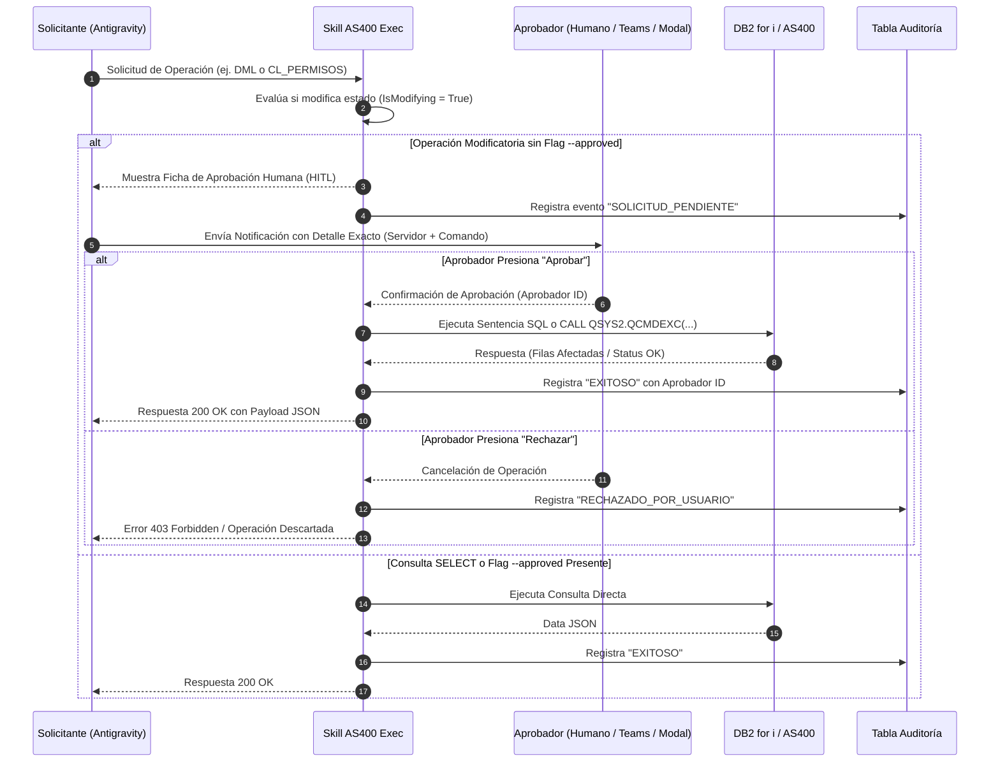

# Arquitectura de Aprobación Humana (Human-in-the-Loop) y Auditoría

Este documento especifica los patrones de arquitectura de seguridad, aprobación previa (*Human-in-the-Loop*) e integración con la Bóveda de Contraseñas CyberArk (PAM) implementados en el Skill **`skill-as400-sql-permisos`**.

---

## 1. Arquitectura de Aprobación Humana (Human-in-the-Loop)

Por política de ciberseguridad y cumplimiento normativo en entornos bancarios e industriales, el Skill **no puede alterar ningún estado ni autorización en el IBM i de forma autónoma**.

### Flujo Sequencial de Aprobación



---

## 2. Plantilla de Notificación de Aprobación

El payload enviado a la interfaz gráfica de Antigravity, correo institucional o bot de Teams/Slack contiene la siguiente información estructurada:

```json
{
  "evento": "SOLICITUD_APROBACION_AS400",
  "transaccion_id": "AUD-20260911074643-F5EB",
  "detalles": {
    "servidor_destino": "192.168.1.100 (AS400-PROD)",
    "tipo_operacion": "CL_PERMISOS",
    "usuario_solicitante": "analista_seguridad",
    "comando_exacto": "CALL QSYS2.QCMDEXC('GRTOBJAUT OBJ(MI_BIB/MI_TABLA) OBJTYPE(*FILE) USER(OPER1) AUT(*ALL)', 67)",
    "motivo": "Ticket #45892 - Asignación de permisos temporales de prueba"
  },
  "acciones_disponibles": [
    { "accion": "APROBAR", "valor": "--approved --approver jefe_seguridad" },
    { "accion": "RECHAZAR", "valor": "--reject" }
  ]
}
```

---

## 3. Autenticación Directa y Captura de Credenciales por Operación

Para garantizar la máxima seguridad y control de accesos sin depender de integraciones externas de bóvedas PAM:

1. **Solicitud Explícita por Operación**:
   En cada ejecución de un comando SQL o permisología CL, el skill solicita de forma interactiva y explícita el **Usuario** y la **Contraseña** del servidor AS400.
2. **Entrada Enmascarada**:
   La captura de la contraseña se realiza mediante mecanismos seguros (`getpass` en Python y `Read-Host -AsSecureString` en PowerShell), evitando que la clave se visualice en la consola.
3. **Ofuscación estricta en Logs**:
   Los ejecutores ([as400_executor.py](../scripts/as400_executor.py) y [as400_executor.ps1](../scripts/as400_executor.ps1)) nunca escriben la contraseña en los registros de auditoría local (`jsonl`) ni en la tabla de auditoría SQL.

---

## 4. Estrategia de Auditoría Multinivel

| Nivel | Almacenamiento | Propósito | Retención Recomendada |
| :--- | :--- | :--- | :--- |
| **Local Agent Log** | File `.agents/skills/skill-as400-sql-permisos/logs/as400_audit.jsonl` | Depuración inmediata y trazabilidad en el agente. | 30 días |
| **Base de Datos Auditoría** | Tabla `AS400_AUDIT_LOG` (DB2 o SQL Server) | Auditoría permanente para SOX / ISO 27001. | 7 años |
| **IBM i Journaling** | Journals nativos QAUDJRN en IBM i | Auditoría forense nativa del sistema operativo. | Determinado por políticas IBM i |
